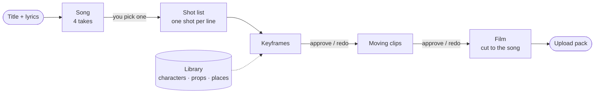

# Rhymeworks

**Turn a song idea into an original, animated kids' song video, entirely on your own Mac.**

You write a title and a few lines of lyrics. Rhymeworks makes the song, plans the shots, draws a keyframe for every
line, animates each one into a moving clip, cuts it all to the music and hands you a finished 1080p film with
thumbnails and the YouTube description. Nothing is uploaded anywhere, and no account or subscription is needed: every
model runs locally on Apple Silicon.

You stay the director. The machine does the slow work, and at every gate you **choose**: pick the song take you like,
approve or redo each picture and each clip, from your desk or from your phone on the sofa.

Rhymeworks was built to make the songs for **Gaana Gaadi** (गाना गाड़ी, "song vehicle"), a channel of English
nursery rhymes and Hindi children's songs. It works for any channel or language you set up.

---

**Contents**

- [What it makes](#what-it-makes)
- [How it works](#how-it-works)
- [What you need](#what-you-need)
- [Install](#install)
- [Your first episode](#your-first-episode)
- [The studio, screen by screen](#the-studio-screen-by-screen)
- [Review from your phone](#review-from-your-phone)
- [Your content folder](#your-content-folder)
- [Characters, props and places](#characters-props-and-places)
- [The episode file](#the-episode-file-episodetoml)
- [Writing good shots](#writing-good-shots)
- [Command line](#command-line)
- [The render queue and your Mac](#the-render-queue-and-your-mac)
- [Troubleshooting](#troubleshooting)
- [How the code is organised](#how-the-code-is-organised)
- [Development](#development)
- [Models and licences](#models-and-licences)
- [Responsible use](#responsible-use)
- [Licence](#licence)

---

## What it makes

One **episode** = one song video, usually 1–3 minutes long:

| Step | You get | Made by |
|---|---|---|
| Song | 4 sung takes of your lyrics in the voice style you pick, scored for how clearly the words come through; the one you pick is mastered to −14 LUFS | ACE-Step 1.5 + Whisper / Parakeet + Spleeter |
| Shot list | One shot per lyric line (who, where, what happens, what they feel), drafted by a local writer model and fully editable | Gemma 4 (Ollama), optional |
| Keyframes | A Pixar-style 3D picture per shot, built from *your* characters and places so they look the same in every shot | FLUX.2 klein 4B |
| Moving clips | Each keyframe animated for the length of its line (about 4–8 s), with lip-sync on the shots you mark as singing | LTX-2.3 |
| Film | Clips cut exactly to the song, your channel intro in front, upscaled to 1920×1080 | ffmpeg |
| Upload pack | Thumbnails with real lettering (Latin and Devanagari), title, description with chapters and lyrics, tags, a YouTube checklist | Gemma 4, CoreText, Pillow |

You upload to YouTube yourself; Rhymeworks never touches your channel.

## How it works



- **Everything is a file you can read.** An episode is one `episode.toml` plus folders of pictures, clips and audio.
  The studio edits that file for you (and checks every change before saving), but you can open it in any editor.
- **Redo is cheap and precise.** A redo picks a new random seed for *that one shot* and re-renders only it.
- **Approvals are honest.** If you change a shot after approving it, its approval goes stale and it asks for review again.
- **One heavy model at a time.** A Mac with 32 GB can run any one of the models comfortably but not two, so all GPU
  work goes through a queue that runs one job at a time.

## What you need

| | |
|---|---|
| Computer | A Mac with Apple Silicon (M1 or newer). Tested on an M2 Max. |
| Memory | **32 GB recommended.** Moving video peaks around 13 GB and picture editing around 20 GB; with 16 GB you can make songs and pictures but clips may fail. |
| Disk | About **80 GB** for the models the first time, plus roughly 1–2 GB per finished episode. |
| macOS tools | [Homebrew](https://brew.sh), then `brew install uv node ffmpeg ollama`, and the Xcode command line tools (`xcode-select --install`, for the lettering tool). |
| Time | A 2-minute episode is about **2–3 hours of rendering** (mostly the clips, about 8 minutes per shot). The studio does it in the background, only during the hours you allow. |

No GPU in the cloud, no Hugging Face account, no API keys. Every model used allows commercial use of what you make
(see [Models and licences](#models-and-licences)).

## Install

```sh
git clone https://github.com/barunprasad/rhymeworks.git
cd rhymeworks
npm run doctor          # checks your Mac and lists what is missing (changes nothing)
npm run setup           # fetches the engines, Python environments, web app and models (about 80 GB; rerun any time)
npm run studio          # opens the studio at http://127.0.0.1:5173 (Ctrl-C stops it)
```

`npm run setup` is safe to stop and rerun: finished parts are skipped. It:

1. checks your tools, memory and free disk;
2. clones the two engines at the tested versions into `spikes/vendor/`: [ltx-2-mlx](https://github.com/dgrauet/ltx-2-mlx) (moving video) and [ACE-Step 1.5](https://github.com/ace-step/ACE-Step-1.5) (songs);
3. creates the Python environments (`uv`) and installs the web app (`npm`);
4. downloads the models: video (LTX-2.3 distilled q4 + its Gemma 3 text encoder) into `spikes/models/`, pictures
   (FLUX.2 klein) and speech scoring (Whisper, Parakeet) into the Hugging Face cache, the song model into the ACE-Step
   folder, the Spleeter vocal splitter, and the optional story helper `gemma4:26b` through Ollama
   (`npm run setup -- --skip-writer` leaves it out; then write the shot prompts yourself).

Once everything is downloaded the models are loaded offline; Rhymeworks never needs the internet again until you update.

## Your first episode

1. **Start the studio**: `npm run studio`. The first start creates your [content folder](#your-content-folder) at `~/Rhymeworks`.
2. **Make your cast** (Library → New character / prop / scene). Describe a character in plain words ("a curious
   six-year-old girl in a yellow frock with two short braids"), get 4 options, keep the one you like. Do the same for at
   least one place (a scene). Every keyframe starts from a scene image, so you need one before the first episode.
3. **New episode**: title, language, lyrics (one line per line of the song). The writer model drafts a shot for every
   line; edit any of them in the **Shot list**.
4. **Song**: pick a voice style, make takes, listen, pick one. Rhymeworks masters it and lines the shots up with the music.
5. **Keyframes**: queue them, then review: approve, redo, or open **Options** to draw 4 versions of a shot and pick one.
6. **Clips**: queue them (this is the long part), then review the same way. **Watch** plays the episode cut to the
   song in the browser at any point: keyframes first, moving clips as they arrive.
7. **Assemble → Package → Upload pack**: the 1080p film, thumbnails and the text to paste into YouTube.

## The studio, screen by screen

The studio is a web app on your Mac, designed **phone first**. On a phone you get a top bar and bottom tabs and review
one shot at a time with big Approve / Redo buttons. From 900 px wide you get the desktop layout with a sidebar.

| Screen | What it is for |
|---|---|
| **Home** | "What shall we make today?": start a new song, ask the Director for a change, continue where you left off, and see what needs you |
| **Episode** | The storyboard: every shot as a picture with its lyric and place, filters (search, status, who, where), and the player. Finished episodes show the film |
| **Watch** | The episode cut to the song, no GPU needed: keyframes (with a slow Ken Burns move) or the moving clips. Full screen with `F` or a double-click |
| **Song** | Voice style, takes with scores, pick and master; or import a song you already have |
| **Shot list** | Edit each shot: place, keyframe prompt, motion, feeling, singing or not, length. Tap a character to insert it |
| **Review** | Keyframes and clips, one at a time: Approve, Redo (new seed, just that shot), or Options |
| **Options** | 4 versions of one keyframe side by side; using one saves its seed and approves it |
| **Director** | Ask for a change in plain words ("make the ending happier", "add the puppy to the river shots"); it proposes edits, and nothing changes until you press Apply |
| **Upload pack** | The finished file, thumbnails, title, description with chapters and lyrics, tags, and a checklist for YouTube Studio |
| **Library** | Every character, prop, place and voice style, where each is used, and "New …" to make more |
| **Queue** | The GPU queue: reorder, cancel, pause, set working hours, clear history |

## Review from your phone

```sh
npm run studio:lan
```

This also serves the studio on your Wi-Fi and prints a QR code (the desktop sidebar shows the same code under
**Open on your phone**). Scan it once and the phone stays linked.

The phone link carries a private key, so other people on the same Wi-Fi can't open your studio:

- your Mac itself is always trusted;
- a phone has to open the QR link once, which sets a cookie holding the key;
- **Make a new link** (under Open on your phone) changes the key and unlinks every phone;
- the API only listens on `127.0.0.1`, refuses requests addressed to any other host name, and only accepts changes
  from the studio's own page, so a website you visit can't queue jobs on your Mac.

The key lives in `studio/lan_key` on your Mac only.

## Your content folder

Your work is kept **outside the code**, so you can update Rhymeworks with `git pull` without touching it, and the code
can be public while your work stays yours.

```
~/Rhymeworks/                  your content folder
├── projects.toml              your channels (name, icon, languages, upload text)
├── episodes/<slug>/           one folder per video
│   ├── episode.toml           the script: song timing and one [[shot]] per line
│   ├── song/                  takes, the mastered song, the isolated vocal
│   ├── keys/                  keyframes (<shot>_a.png, end frames <shot>_b.png, options/, contact.jpg)
│   ├── clips/                 moving clips (<shot>.mp4, contact.jpg)
│   ├── review.toml            your approvals
│   └── upload/                1080p film, thumbnails, upload_text.md
└── assets/
    ├── registry.toml          your characters, props and places, described once
    ├── cast/  props/  scenes/ their pictures
    ├── voices.toml  voices/   voice styles and their samples
    └── brand/                 optional: intro/intro.mp4 (put in front of every film) and your icon
```

```sh
uv run --project pipeline kidzone home                    # where is my content folder?
uv run --project pipeline kidzone home --set "<folder>"   # use another one (a new folder is filled with the starter files)
```

**On more than one computer**: put the content folder inside Google Drive for desktop, iCloud Drive or Dropbox and
point each computer at it with `kidzone home --set`. The folder is chosen in this order: the `RHYMEWORKS_HOME`
environment variable, then `rhymeworks.local.toml` in the repo (written by `home --set`, never committed), then
`~/Rhymeworks`.

Things that stay on **this computer only**, in `studio/` inside the repo, never synced or committed: the job queue
(`studio.db`), logs, library drafts and the phone key. A library draft may use a photo of a real adult as a reference;
that needs `"adult_consent": true` in the draft. Never use photos of children.

## Characters, props and places

Everything that appears in more than one shot is described once in `assets/registry.toml`. The studio's Library
writes this file for you; this is what it looks like:

```toml
[cast.asha]
file = "cast/asha.png"                                   # the character sheet (relative to assets/)
ref = "the girl in the yellow frock"                     # how prompts refer to her
style = "The girl in the yellow frock has two short braids."   # added to every keyframe she is in
person = true                                            # counts as a human (for "exactly N characters")
# alone = "…"                                            # added when she is the only person in the shot

[props.cart]
file = "props/cart.png"
ref = "the little red wooden cart"
keep = "The cart keeps its exact shape and colours"      # {keep:cart} in a motion prompt

[scenes]
meadow = "scenes/meadow.png"                             # a scene is always the first image of a keyframe
```

In a keyframe prompt, `{asha}` becomes "the girl in the yellow frock (second image)" and her picture is attached
automatically. `{Asha}` capitalises, `{asha|the girl}` keeps the picture but uses your words.

## The episode file (`episode.toml`)

The studio writes this for you. A minimal example (the full starter with comments is `templates/episode.toml`):

```toml
[episode]
title = "Little Red Kite"
lang = "en"                       # en | hi
output = "little_red_kite_en.mp4"
# project = "my-channel"          # which channel (default: the first in projects.toml)

[song]
audio = "song/master_en.wav"
vocals = "song/vox_en.wav"        # isolated vocal, for lip-sync shots
line_seconds = 4.137931           # length of one lyric line (2 bars at 116 bpm)

[[shot]]
id = "s01"
seed = 101
scene = "meadow"
key = "{Asha} runs across the meadow holding the string of a red kite, laughing. Medium-wide shot."
motion = "The girl runs from the left of the frame to the right while the kite climbs; the camera holds still"
feel = "pure joy"
end = { seed = 1001, key = "Same meadow: {asha} has reached the RIGHT side of the frame, the kite high above her." }
```

| Field | Where | Meaning |
|---|---|---|
| `title`, `lang`, `output` | `[episode]` | Name, language (`en` / `hi`), file name of the assembled film |
| `project`, `playlist`, `status` | `[episode]` | Channel id, YouTube playlist, `"published"` once it is out (counts as approved) |
| `width`, `height`, `fps`, `seed` | `[render]` | Defaults 1280×720 at 24 fps, seed 7 |
| `audio`, `vocals`, `line_seconds`, `seconds`, `lipsync_lead` | `[song]` | The mastered song, isolated vocal, seconds per lyric line, total length (default: the song's), lip-sync offset (0.167 s) |
| `keyframe`, `clip`, `no_people` | `[style]` | Override the default style text |
| any name | `[vars]` | Reusable text: `{sit}` in a prompt becomes its value |
| `id`, `seed` | `[[shot]]` | Shot id (`s00`, `s01` …) and keyframe seed |
| `scene` | `[[shot]]` | A key of `[scenes]` in the registry |
| `key` | `[[shot]]` | What the keyframe shows (use tokens for your characters) |
| `motion` | `[[shot]]` | What moves during the clip, in plain words (no character tokens; `{keep:prop}` and `[vars]` work) |
| `feel` | `[[shot]]` | The feeling that must read on faces; on non-singing shots it also says nobody sings or talks |
| `sing` | `[[shot]]` | `true` = lip-sync to the vocal for this shot |
| `end` | `[[shot]]` | `{ seed, key }` = a separate end keyframe (best for travel); `"same"` = end on the start frame (seated shots only) |
| `lines`, `frames`, `clip_seed` | `[[shot]]` | Shot spans N lyric lines; exact frame count (8k+1); seed of the moving clip (a clip redo changes it) |

## Writing good shots

These come from making real episodes; the engine's defaults already follow them, but your prompts matter most.

- **Name only who is in the shot**, and say how many: "exactly two characters, each once". Place each one by name
  ("on the left {asha}, on the right {ravi}"). Never write "the two children": the picture model then often draws
  one child twice.
- **Make travel read as travel.** Keep the camera still and let characters cross the frame or run away from it, with
  an end keyframe further along. A camera that "follows" or "tracks" them makes them run on the spot.
- **`end = "same"` only for shots where everyone stays put** (seated, listening). A boat or a runner pinned to its
  start frame goes nowhere. After clips, `pipeline/tools/motion_check.py <episode>/clips/s*.mp4` flags frozen clips;
  redo those.
- **Never give anyone more jobs than hands.** "Carries a box in both arms and waves" grows a third hand. Let them nod
  or smile instead.
- **Show feelings, not mouths.** Use `feel` on every shot and `sing = true` on a few key lines only; a whole cast
  mouthing every word looks odd.
- **Vehicles stay in the middle distance** and never "bounce" or "dance" (they take off). Seats face the camera.
- **Lettering is never drawn by the picture model**: thumbnails and titles are set with a real font afterwards, which
  also renders Devanagari correctly.

## Command line

Everything the studio does is also a command (run from the repo; a bare episode name is looked up in your content folder):

```sh
uv run --project pipeline kidzone pixar <episode> --plan              # print every resolved prompt and timing
uv run --project pipeline kidzone pixar <episode> --phase keys        # keyframes  → keys/contact.jpg
uv run --project pipeline kidzone pixar <episode> --phase clips       # clips      → clips/contact.jpg
uv run --project pipeline kidzone pixar <episode> --phase assemble    # the film, cut to the song
uv run --project pipeline kidzone pixar <episode> --phase package     # upload/<name>_1080p.mp4 with your intro
uv run --project pipeline kidzone pixar <episode> --phase clips --redo s05   # redo one shot (also --only s03 s04)
```

| Command | Does |
|---|---|
| `kidzone song <episode> [--n 4]` | Make song takes; `--master <take>` masters the one you picked; `--import <audio>` uses a song you already have and rebuilds the shots on its bar grid |
| `kidzone draft <episode> [--all]` | Let the writer model fill empty shot prompts |
| `kidzone options <episode> <shot> [--n 4]` | Draw N versions of one keyframe |
| `kidzone director <episode> --ask "…"` | Propose shot-list changes (applied from the studio) |
| `kidzone upload <episode>` | Upload text and thumbnails |
| `kidzone asset <draft>` | 4 options for a library draft |
| `kidzone voice <id>` | A 30 s sample of a voice style |
| `kidzone home [--set DIR]`, `kidzone migrate --to DIR` | Show or change the content folder; move content that still lives in the repo out of it |
| `kidzone studio [--port 8765]` | Just the API (normally started by `npm run studio`) |

Every phase is resumable: finished shots are skipped, so you can stop and continue at any time. `--dry-run` prints the
commands without running them.

## The render queue and your Mac

- **One GPU job at a time.** Keyframes, clips, songs, options and library pictures all wait in one queue (the
  Queue screen), which you can reorder, cancel or pause.
- **Working hours.** By default jobs only start between 09:00 and 22:00, so your Mac isn't rendering all night.
  Change or switch this off in the Queue settings. Quick jobs (the Director) run any time.
- **Plays nicely with other AI apps.** If another large model is loaded in Ollama, the queue waits for it to finish.
- **Close heavy apps** while clips render; memory is the limit, not speed.

## Troubleshooting

| Problem | Fix |
|---|---|
| `npm run studio` says the app isn't installed | Run `npm run setup` |
| Anything about a missing model or engine | `npm run doctor` shows what is missing; `npm run setup` fetches it |
| "This phone isn't linked yet" | Scan the QR code again (Open on your phone on the Mac) |
| A clip barely moves | Run the motion check, remove `end = "same"` for anything that should travel, and redo the clip |
| An extra or doubled character | Name every character by position, say "exactly N", and redo the keyframe (or open Options) |
| The queue never starts | Check that it isn't paused and that you are inside the working hours (Queue screen) |
| Songs or the Director fail | Make sure Ollama is running (`ollama serve`) and the song server isn't blocked by another app on port 8001 |
| Out of memory, the Mac swaps | Close other apps; never run another large model while clips render |

## How the code is organised

```
pipeline/            Python: the kidzone CLI, the engines' glue and the studio API
  kidzone/pixar.py     the episode engine (keyframes, clips, assembly, packaging)
  kidzone/paths.py     where everything lives (code, content folder, this computer's state)
  kidzone/songmaker.py songs: takes, scoring, mastering, import
  kidzone/studio/      FastAPI app, SQLite job queue, worker, review, validated episode/registry writers, phone lock
  tools/               melody guide, mastering, vocal split, motion check, brand tools (font, lettering, intro)
packages/studio/     the studio web app (React 19 + Vite + TypeScript, no UI framework)
scripts/             studio.mjs (npm run studio) and setup-engines.sh (npm run setup / doctor)
templates/           a new episode, and the starter content folder
spikes/              engines, models and Python environments (downloaded by setup; only the lock files are in git)
packages/compositions/, pipeline/kidzone/stages/   the earlier 2D pipeline (Remotion; `kidzone run <brief.json>`), kept working
PLAN.md              the original plan for the 2D pipeline
```

- The studio API runs on `127.0.0.1:8765` and the web app on `:5173`, which proxies `/api` and `/files` to it.
  Live updates arrive over one server-sent events stream (`/api/events`).
- GPU work runs as `kidzone` subprocesses started by the worker, so a crash never takes down the studio.
- Every write to an `episode.toml` or `registry.toml` keeps your formatting and comments, and is checked by loading
  the result with the engine before it is saved.
- The studio's QR encoder (`packages/studio/src/lib/qr.js`) is its own, with no dependencies, and shared by the launcher and the app.

## Development

```sh
npm test            # Python tests (pytest) + TypeScript type check
npm run build       # production build of the web app
npm run doctor      # what is installed
```

Tests that need a particular episode skip themselves when it isn't in your content folder. Code must find files
through `pipeline/kidzone/paths.py` and never assume content lives inside the repo.

## Models and licences

Every model is downloaded once and runs offline. Each allows commercial use of its outputs; read the linked terms for
the details (the LTX-2 licence in particular has a revenue threshold for large companies).

| Used for | Model | Licence |
|---|---|---|
| Pictures | [FLUX.2 klein 4B](https://huggingface.co/black-forest-labs/FLUX.2-klein-4B), 4-bit ([mflux](https://github.com/filipstrand/mflux)) | Apache 2.0 |
| Moving video | [LTX-2.3](https://github.com/Lightricks/LTX-2) distilled, 4-bit MLX ([ltx-2-mlx](https://github.com/dgrauet/ltx-2-mlx), MIT) | [LTX-2 Community License](https://github.com/Lightricks/LTX-2/blob/main/LICENSE-2) |
| Video text encoder | Gemma 3 12B instruct, 4-bit MLX | [Gemma Terms of Use](https://ai.google.dev/gemma/terms) |
| Songs | [ACE-Step 1.5](https://github.com/ace-step/ACE-Step-1.5) | MIT |
| Story helper (optional) | Gemma 4 26B via [Ollama](https://ollama.com) | Apache 2.0 |
| Song scoring | Whisper large-v3 turbo (MLX), Parakeet TDT 0.6B v2 (MLX) | MIT, CC-BY-4.0 |
| Vocal splitter | [Spleeter](https://github.com/deezer/spleeter) 2 stems | MIT |
| Lettering | Baloo 2 font (`pipeline/tools/brand/fonts/`) | SIL Open Font License |
| 2D pipeline (optional) | [Remotion](https://www.remotion.dev) | [Remotion License](https://www.remotion.dev/license) (free for individuals and small teams) |

## Responsible use

- **Say it is AI.** When you upload, answer **Yes** to YouTube's altered or synthetic content question (the upload
  checklist reminds you). Mark kids' videos **Made for Kids**.
- **Only original or public-domain songs.** Write your own lyrics or use traditional tunes; don't recreate songs
  someone else owns.
- **No real children.** Never use a photo of a child as a reference. The library only accepts a photo reference once
  you confirm it shows an adult who agreed to it (`"adult_consent": true` in the draft); without that it refuses.
- **Check what you publish.** Watch every video in full before uploading; models make mistakes a child shouldn't see.

## Licence

The Rhymeworks code is released under the [MIT License](LICENSE). The models, engines and fonts it downloads keep
their own licences (see [Models and licences](#models-and-licences)). What you make with it is yours.
